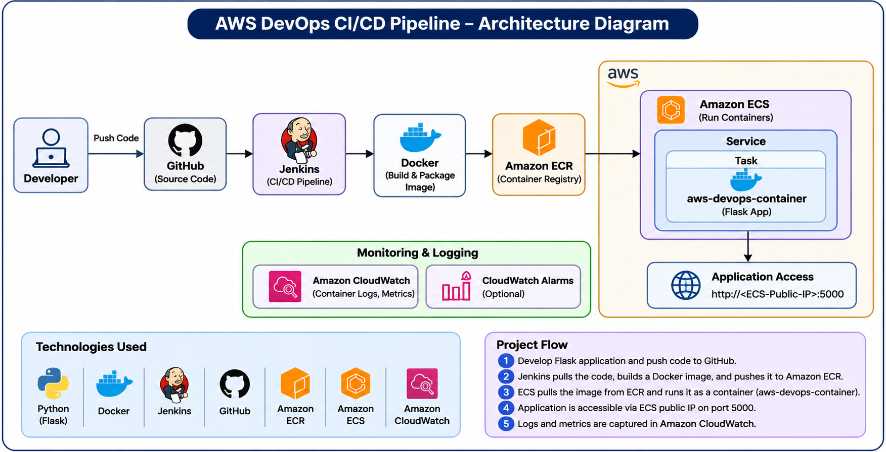
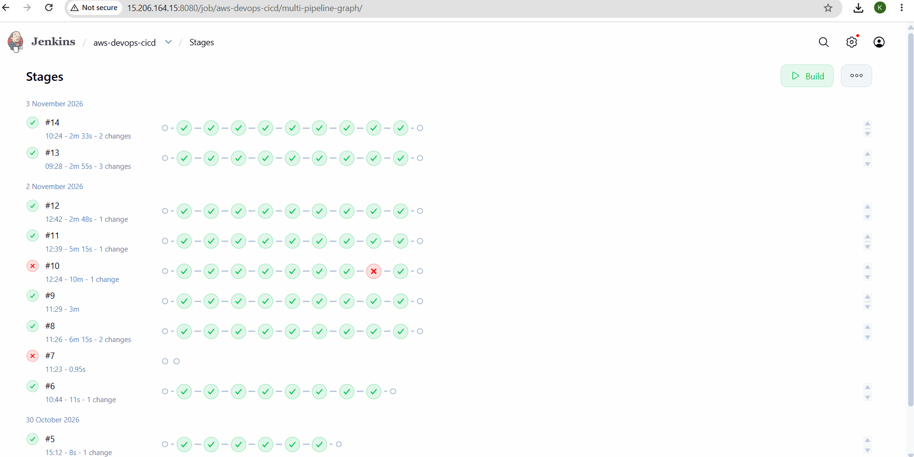
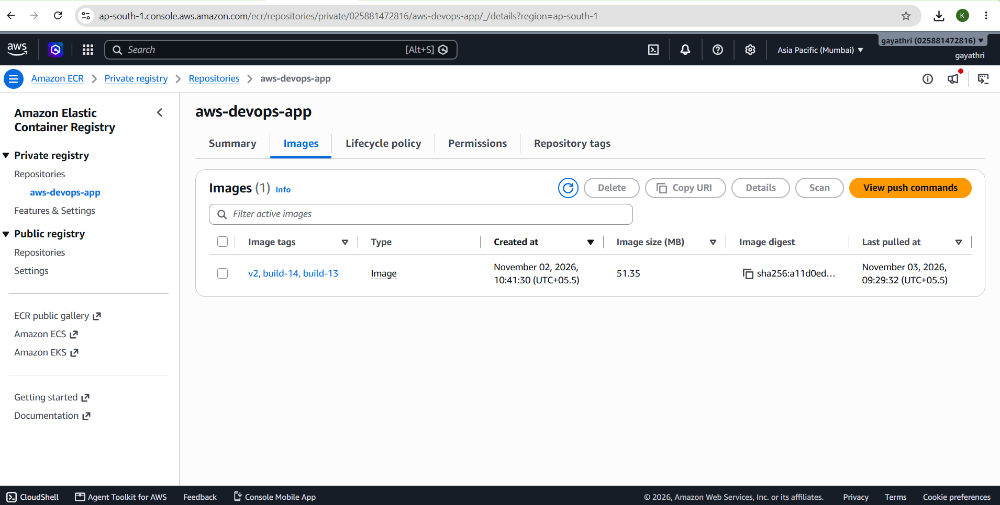
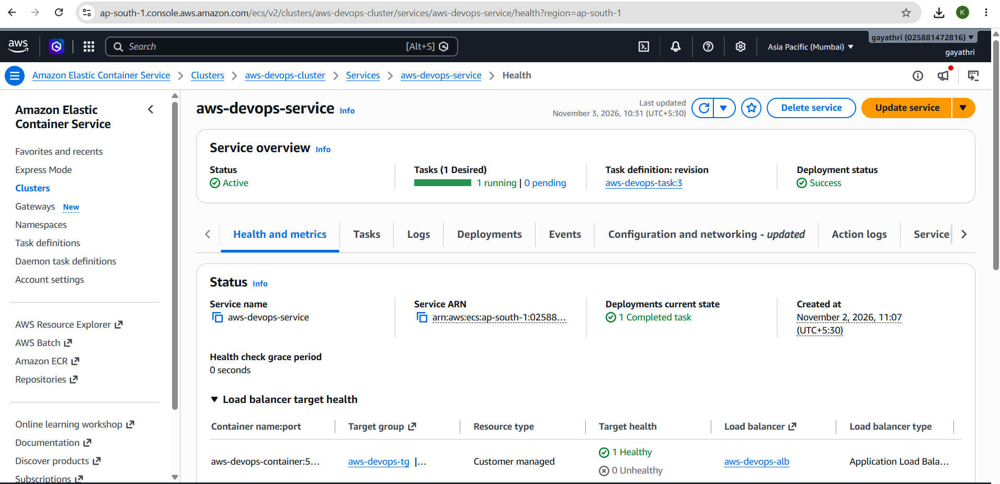
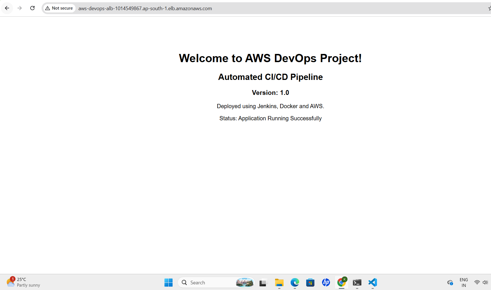
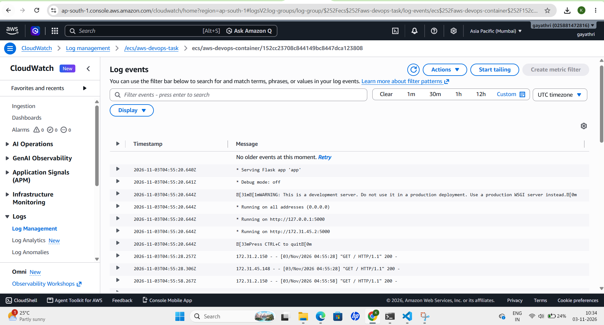
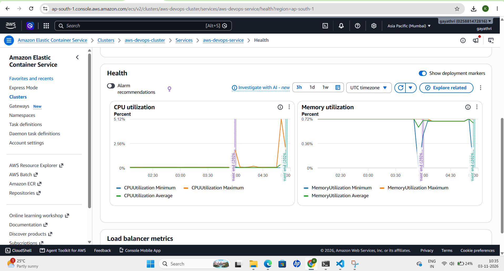

# AWS DevOps End-to-End CI/CD Pipeline

An automated CI/CD pipeline to build, test, containerize and deploy a Python Flask application on AWS using Jenkins, Docker, Amazon ECR and Amazon ECS Fargate.

## Project Overview

This project demonstrates an end-to-end DevOps workflow in which application code is maintained in GitHub and automatically processed through a Jenkins pipeline.

Jenkins validates the Python application, builds and tests a Docker image, pushes the image to Amazon Elastic Container Registry (ECR), and deploys a new task-definition revision to Amazon Elastic Container Service (ECS) Fargate.

An Application Load Balancer (ALB) provides access to the deployed application, while Amazon CloudWatch collects container logs and provides monitoring metrics.

## Architecture



## Architecture Diagram


## Project Screenshots

### 1. Jenkins CI/CD Pipeline


### 2. Amazon ECR - Docker Images


### 3. Amazon ECS - Deployment Status


### 4. Application Output


### 5. Amazon CloudWatch - Application Logs


### 6. ECS - CPU and Memory Monitoring


**Pipeline flow:**

Developer → GitHub → Jenkins → Python Validation → Docker Build → Application Test → Amazon ECR → Amazon ECS Fargate → Application Load Balancer → End Users

Amazon CloudWatch collects application logs and ECS monitoring metrics.

## Technologies Used

| Category | Technology |
|---|---|
| Cloud Platform | Amazon Web Services (AWS) |
| Operating System | Ubuntu Linux |
| Source Code Management | Git and GitHub |
| CI/CD Automation | Jenkins |
| Containerization | Docker |
| Container Registry | Amazon ECR |
| Container Deployment | Amazon ECS Fargate |
| Load Balancing | Application Load Balancer |
| Monitoring and Logging | Amazon CloudWatch |
| Application Framework | Python Flask |
| Infrastructure Networking | Amazon VPC |
| Access Management | AWS IAM |
| Webhook Connectivity | GitHub Webhook and Cloudflare Tunnel |

## Project Structure

```text
aws-devops-cicd-pipeline/
├── app.py
├── requirements.txt
├── Dockerfile
├── Jenkinsfile
├── .gitignore
├── README.md
└── docs/
    └── aws-devops-architecture.png
```

## Application Details

The application is developed using Python Flask.

| Endpoint | Description |
|---|---|
| `/` | Displays the application homepage |
| `/health` | Returns application health status and version |

**Sample health-check response:**

```json
{
  "status": "healthy",
  "version": "1.0"
}
```

## CI/CD Pipeline Workflow

### 1. Source Code Checkout
- Retrieves application source code from the GitHub repository.
- Uses Jenkins Pipeline from Source Control Management (SCM).

### 2. Python Validation
- Checks Python syntax using `python3 -m py_compile app.py`.
- Stops the pipeline if validation fails.

### 3. Docker Image Build
- Builds a Docker image using the project Dockerfile.
- Uses a unique build-number-based image tag.

### 4. Application Testing
- Runs the Docker container temporarily.
- Tests the `/health` endpoint.
- Removes the temporary test container after execution.

### 5. Amazon ECR Authentication
- Authenticates Docker with Amazon ECR using AWS CLI.
- Uses the IAM role attached to the Jenkins EC2 instance.

### 6. Docker Image Push
- Tags the image with the ECR repository URI.
- Pushes the uniquely tagged image to Amazon ECR.

### 7. Amazon ECS Deployment
- Retrieves the existing ECS task definition.
- Updates the application container image.
- Registers a new task-definition revision.
- Updates the ECS service to use the new revision.
- Waits for the ECS deployment to complete.

### 8. Monitoring and Logging
- Amazon CloudWatch receives application container logs.
- ECS service metrics provide CPU and memory utilization information.

## AWS Resources Used

| AWS Service | Purpose |
|---|---|
| Amazon EC2 | Hosts the Jenkins server |
| AWS IAM | Provides secure access permissions |
| Amazon VPC | Provides application networking |
| Internet Gateway | Provides internet connectivity for configured public subnets |
| Amazon ECR | Stores Docker images |
| Amazon ECS | Manages container deployment |
| AWS Fargate | Runs containers without managing EC2 container hosts |
| Application Load Balancer | Distributes incoming application traffic |
| Amazon CloudWatch | Collects logs and monitoring metrics |

**Configured resource names:**

- ECR repository: `aws-devops-app`
- ECS cluster: `aws-devops-cluster`
- ECS service: `aws-devops-service`
- ECS task-definition family: `aws-devops-task`
- Container name: `aws-devops-container`
- CloudWatch log group: `/ecs/aws-devops-task`
- AWS Region: `ap-south-1` (Mumbai)

## Running the Application Locally

### Prerequisites
- Python 3.11 or later
- pip
- Git

### Clone the repository

```bash
git clone https://github.com/Gayathri-9390/aws-devops-cicd-pipeline.git
cd aws-devops-cicd-pipeline
```

### Install dependencies

```bash
pip install -r requirements.txt
```

### Start the application

```bash
python app.py
```

Open:
- Homepage: `http://localhost:5000/`
- Health check: `http://localhost:5000/health`

## Docker Usage

### Build the Docker image

```bash
docker build -t aws-devops-app:v1 .
```

### Run the container

```bash
docker run -d -p 5000:5000 --name aws-devops-app aws-devops-app:v1
```

### Verify the application

```bash
curl http://localhost:5000/health
```

### Stop and remove the container

```bash
docker rm -f aws-devops-app
```

## Deployment Verification

The successful deployment was verified through:

- Jenkins pipeline execution.
- Docker image creation and push to Amazon ECR.
- New ECS task-definition revision registration.
- ECS service deployment and running task verification.
- Application access through the Application Load Balancer.
- Successful `/health` endpoint response.
- Application logs visible in Amazon CloudWatch.
- ECS CPU and memory monitoring metrics.

## Monitoring and Logging

Amazon CloudWatch is configured with the following log group:

```text
/ecs/aws-devops-task
```

The `awslogs` log driver forwards container output to CloudWatch.

ECS service metrics are available for monitoring CPU and memory utilization.

## Key Learning Outcomes

- Understanding end-to-end CI/CD automation.
- Integrating GitHub with Jenkins.
- Building and testing Docker containers.
- Integrating Jenkins with AWS IAM and ECR.
- Deploying containerized applications using ECS Fargate.
- Configuring an Application Load Balancer.
- Managing ECS task-definition revisions.
- Monitoring application logs and service metrics through CloudWatch.
- Troubleshooting deployment and connectivity issues.

## Future Enhancements

- Add automated unit testing using Pytest.
- Integrate SonarQube for code quality analysis.
- Add Trivy Docker image vulnerability scanning.
- Use Gunicorn as the production WSGI server.
- Configure CloudWatch alarms and SNS email notifications.
- Automate AWS infrastructure provisioning using Terraform.
- Implement deployment rollback strategies.
- Configure HTTPS using an SSL/TLS certificate.

## Author

**Gayathri Kadiyala**

GitHub: [Gayathri-9390](https://github.com/Gayathri-9390)

Project Repository: [AWS DevOps CI/CD Pipeline](https://github.com/Gayathri-9390/aws-devops-cicd-pipeline)git add README.md docs/